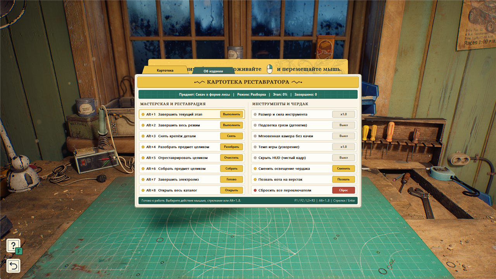
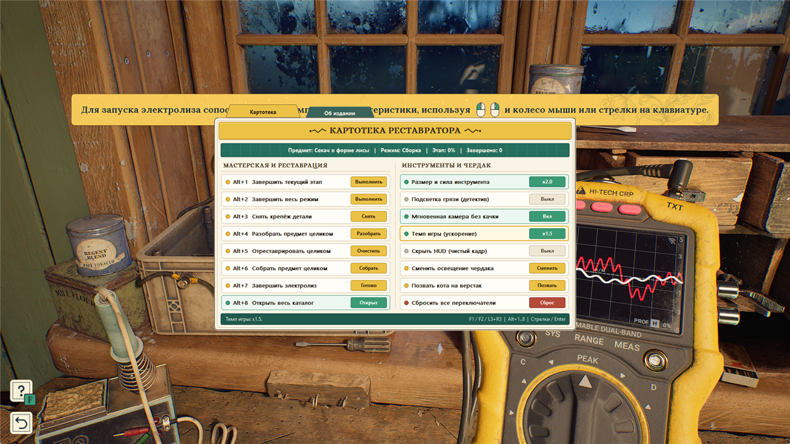
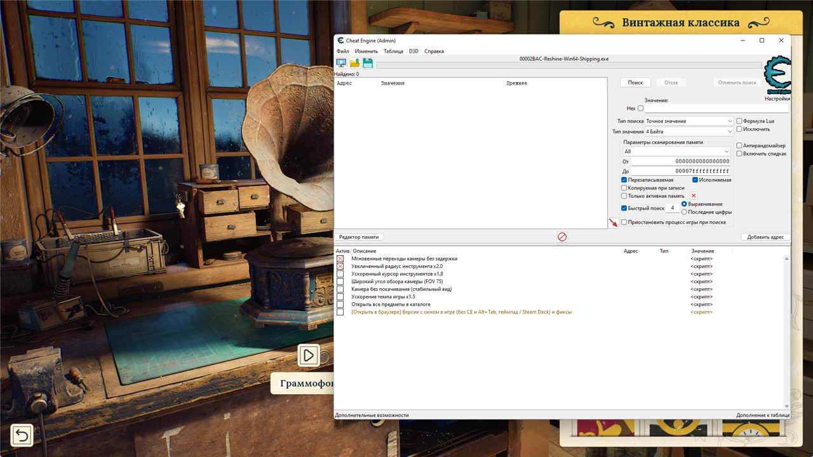
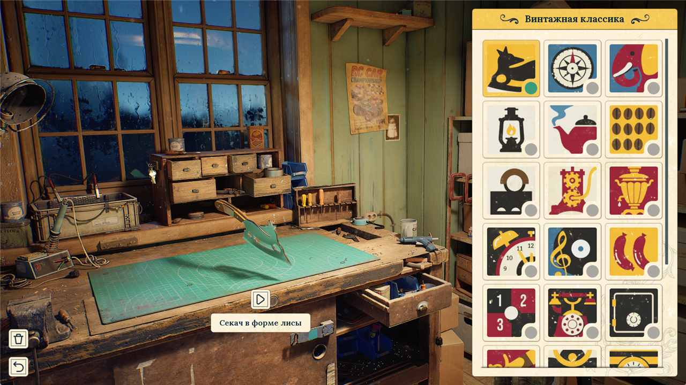

# Reshine - Картотека реставратора, таблица .CT и сохранение (v1.0)

Мгновенная разборка, очистка и сборка предметов, завершение электролиза, открытие всего каталога, подсветка грязи, усиление инструмента, мгновенная камера и атмосфера чердака для **Reshine** (`build 5173`, Windows и Steam Deck).

## Скачать
- **[Внутриигровая «Картотека реставратора» на Boosty](https://boosty.to/cd_tixo/posts/01243865-3899-432b-a787-d2d7b1a0ac80)** (ранний доступ 7 дней: подписка `120 ₽/мес` на все релизы или разовый пост `150 ₽`, откроется всем **4 декабря 2026**)
- **[Таблица .CT и сохранение на GitHub Releases](https://github.com/neoru-droid/reshine-mod-ru/releases)**
- **[Страница игры в каталоге](https://neoru-droid.github.io/games/reshine/)**

## Установка

1. **Windows:** распакуйте `Reshine-Trainer-RU-v1.0.zip` и запустите `Reshine-Trainer-Setup.exe` -> **«Установить мод-меню»**.
2. **Steam Deck / Linux (Proton):** выполните `sh install-steamdeck.sh`.
3. В игре открывайте «Картотеку реставратора» клавишей `F1`, `F2` или `L3 + R3` на геймпаде.
4. **Удаление:** запустите установщик и нажмите **«Удалить мод-меню»** (или `sh install-steamdeck.sh --uninstall`).

## Что внутри «Картотеки реставратора»

### Верстак и реставрация (`Alt+1..8`)
1. `Alt+1` - **Завершить текущий этап** очистки или покраски
2. `Alt+2` - **Завершить весь режим** (разборка / реставрация / сборка)
3. `Alt+3` - **Снять крепёж детали** (винты и гвозди сразу)
4. `Alt+4` - **Разобрать предмет целиком**
5. `Alt+5` - **Отреставрировать целиком**
6. `Alt+6` - **Собрать предмет целиком**
7. `Alt+7` - **Завершить электролиз** в ванне без ожидания
8. `Alt+8` - **Открыть весь каталог** предметов сразу

### Инструменты и чердак
1. **Размер и сила инструмента** (`x1.0 / x2.0 / x3.0`)
2. **Подсветка грязи (детектив)** - постоянная подсветка пропущенных пятен
3. **Мгновенная камера без качки** - быстрые переходы без задержки и покачивания
4. **Темп игры** (`x1.0 / x1.5 / x2.0`)
5. **Скрыть HUD (чистый кадр)** для скриншотов
6. **Сменить освещение чердака** в один клик
7. **Позвать кота на верстак**
8. **Сбросить все переключатели**

## Таблица Cheat Engine (`Reshine_RU_v1.0.CT`)

Отдельная таблица для Cheat Engine 7.5+ (`Reshine-CheatTable-RU-v1.0.zip`) подключается к процессу `Reshine-Win64-Shipping.exe`: мгновенные переходы камеры, увеличенный радиус инструмента x2.0, ускоренный курсор x1.8, широкий угол обзора FOV 75, камера без покачивания, темп игры x1.5 и открытие каталога.

## Готовое сохранение (`Reshine-Save-RU-v1.0.zip`)

Готовое сохранение с открытыми предметами каталога и пройденным обучением. Распакуйте папку `SaveGames` в `%LOCALAPPDATA%\Reshine\Saved\SaveGames`.

## Обратная связь и проекты автора

Заметили баг после патча игры - пишите в [Issues](https://github.com/neoru-droid/reshine-mod-ru/issues).

Предложить свою игру в очередь (`350 ₽`) или заказать разбор вне очереди (`750 ₽`) можно на [Boosty](https://boosty.to/cd_tixo) (подписка `120 ₽/мес` на все релизы или разовый пост `150 ₽`).

Все проекты автора: [каталог на сайте](https://neoru-droid.github.io/) · [каталог на Boosty](https://boosty.to/cd_tixo/posts/2a55d7e9-0f53-4d93-9f66-280981158dec) · [Telegram (@neoru_droid)](https://t.me/neoru_droid)

Лицензия: [MIT](LICENSE)

Автор: `neoru-droid`
